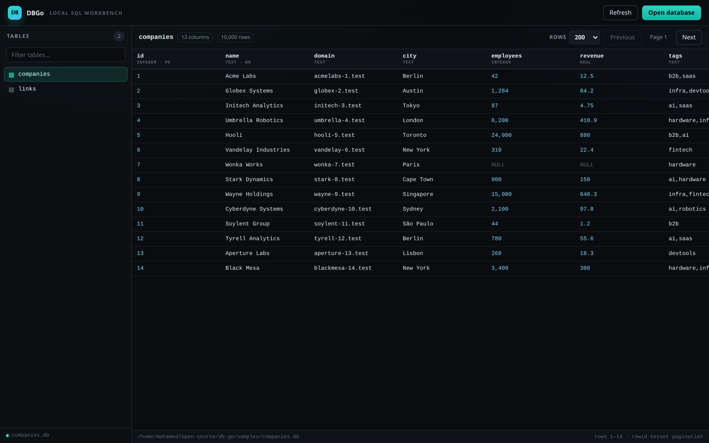
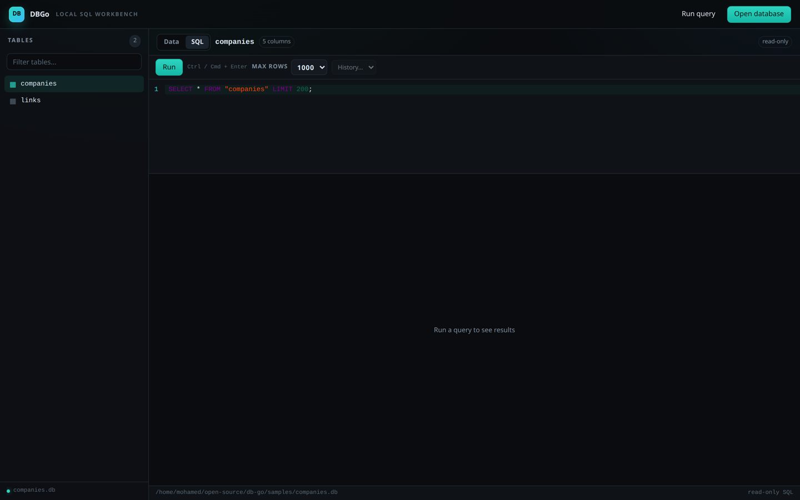
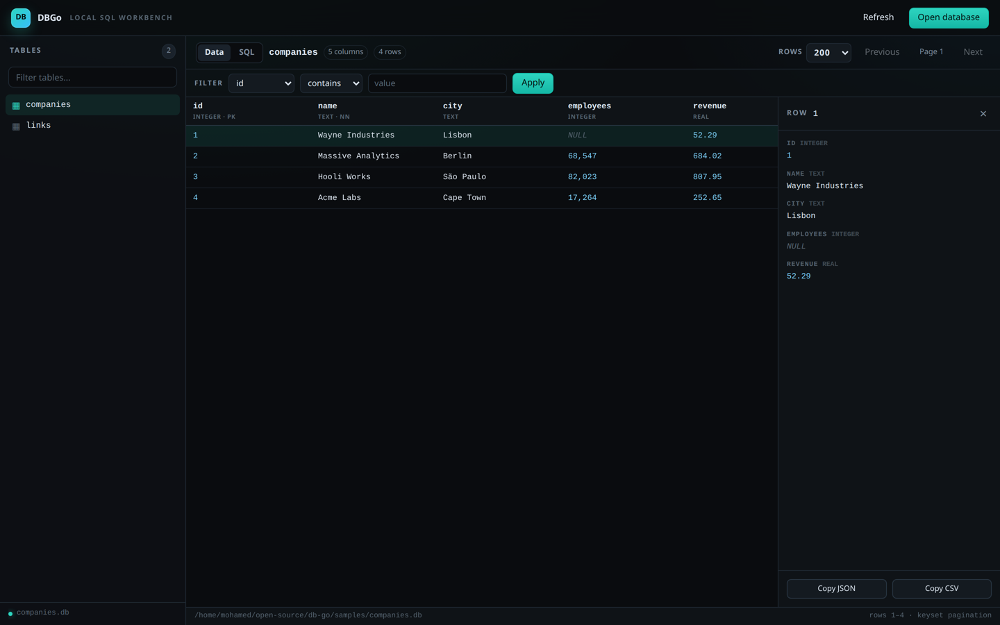
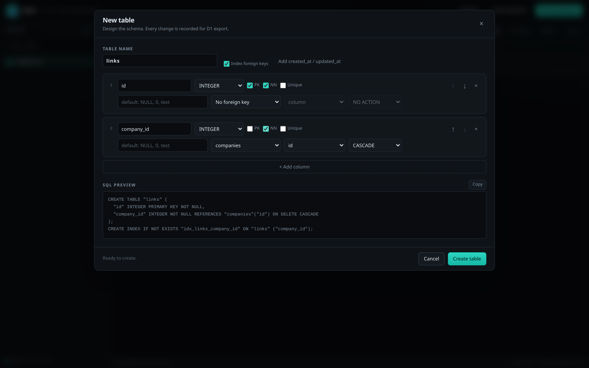
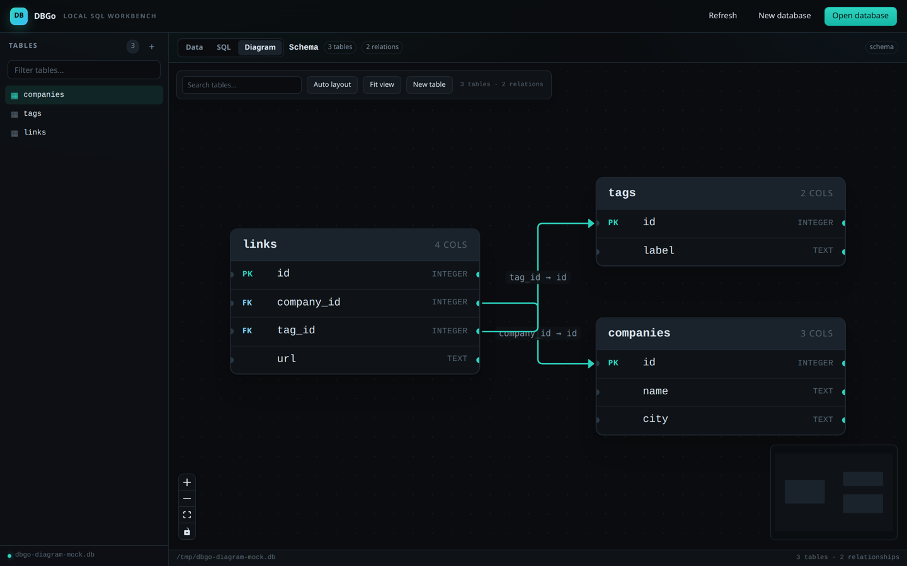

# DBGo

A fast, local-first SQL workbench. Open a SQLite database, browse tables, write
SQL, and move through rows without loading the whole table into memory.









What's here so far:

- Tauri 2 native desktop window (no browser app, no server)
- Rust core with SQLite (WAL, memory-mapped I/O)
- Create a database project: `db.sqlite`, `AGENTS.md`, `schema.md`, `migrations/`, `backups/`
- Open an existing SQLite file with the native file picker
- Visual table designer: types, PK/NN/unique, defaults, foreign keys, FK indexes
- Structure inspector: DDL, columns, indexes, foreign keys, and index management
- Alter tables from the GUI or CLI: add, rename, and drop columns with SQL preview
- Indexes, views, and numbered migration files
- Every schema change gets a backup, an audit row, and a migration record
- List tables in the sidebar
- Browse rows with a virtualized grid
- Keyset pagination (`rowid`) — fast on large tables
- Row count capped at 1,000,000 to avoid expensive full counts
- NULL / integer / real / text / BLOB cell rendering
- SQL editor (CodeMirror 6) with schema-aware autocomplete and `Ctrl/Cmd+Enter`
- Query history and read-only query results in the same grid
- Click-to-sort columns, server-side filtering, and a row detail panel
- Interactive ERD diagram: foreign-key edges, auto-layout, search, drag positions
- GUI data editing with staged changes and one explicit **Save changes**
- Backup browser and safe restore with an automatic pre-restore snapshot
- CLI writes: insert, upsert, update, delete, with automatic backups and audit
- Live refresh when the CLI changes the open database
- `dbgo` CLI with human, JSON, and JSONL output, plus `dbgo init`
- Tailwind CSS v4 UI

## Requirements

- Rust 1.85+ (tested with 1.99)
- Node.js 20+ and pnpm
- Linux: `webkit2gtk-4.1`, `gtk+-3.0`, `libsoup-3.0`, `javascriptcoregtk-4.1`

## Run

```bash
pnpm install
pnpm tauri:dev
```

Open a database directly from the command line (after a build):

```bash
pnpm tauri:build --no-bundle
./target/release/db-go samples/companies.db
```

During development, run `pnpm tauri:dev` and use the Open database button.

Build a release bundle:

```bash
pnpm tauri:build
```

## CLI

Install the `dbgo` command:

```bash
cargo install --path crates/cli
```

That puts `dbgo` in `~/.cargo/bin`, which is already on `PATH` for Rust users.
Then, from anywhere:

```bash
dbgo init ./database              # project folder
dbgo init ./app.db --single-file  # bare SQLite file

dbgo tables  ./samples/companies.db
dbgo schema  ./samples/companies.db companies
dbgo count   ./samples/companies.db companies
dbgo page    ./samples/companies.db companies --limit 50 --cursor 201
dbgo query   ./samples/companies.db "select id, name, city from companies limit 20"

# project commands (run inside the project folder)
cd database
dbgo graph . --json
dbgo create-table . --file table.json
dbgo alter-table . companies --add-column '{"name":"country","type_name":"TEXT","primary_key":false,"not_null":false,"unique":false,"default_value":null,"references":null}'
dbgo alter-table . companies --rename-column city=location
dbgo alter-table . companies --drop-column legacy_id --yes
dbgo index create . companies --name idx_companies_city --columns city
dbgo index list . companies
dbgo view create . active_companies --sql "select * from companies where active = 1"
dbgo migrations .
dbgo migrate .
dbgo insert . companies --file rows.jsonl
dbgo upsert . companies --key domain --file rows.jsonl
dbgo update . companies --where '{"column":"id","op":"eq","value":1}' --set '{"city":"Berlin"}' --yes
dbgo delete . companies --where '{"column":"id","op":"eq","value":1}' --yes
dbgo sessions .
dbgo backup .
dbgo backups .
dbgo restore . --latest --yes
# or restore one specific snapshot:
dbgo restore . --backup backups/db.sqlite.bak-1794310717376 --yes

# machine-readable
dbgo --json  tables ./samples/companies.db
dbgo --jsonl query  ./samples/companies.db "select * from companies limit 100"
```

`dbgo init ./database` creates a project folder with the database, an agent
guide, a schema snapshot, migrations, and backups. Add `--force` to replace an
existing project; a timestamped backup is kept.

## Create a database project

- GUI: click **Create database**, choose a folder, then design your first table.
- CLI: `dbgo init ./database` (or `dbgo init ./app.db --single-file` for a bare DB).
- The table designer supports primary keys, NOT NULL, UNIQUE, defaults,
  foreign keys, ON DELETE actions, and indexes on foreign keys.
- A live SQL preview shows exactly what will run. Every schema change is
  recorded in the hidden `_dbgo_migrations` table and in `migrations/`.

A project looks like this:

```
database/
├── db.sqlite
├── AGENTS.md        # instructions for coding agents
├── schema.md        # generated schema snapshot
├── dbgo.json        # project config
├── migrations/      # numbered DDL, ready for D1
└── backups/         # timestamped snapshots
```

The agent should work from that folder and use `.` as the database path:

```bash
dbgo graph . --json
dbgo create-table . --file table.json
dbgo backup .
```

`query` is read-only. `page` uses keyset pagination on `rowid`. Run
`dbgo <command> --help` for details.

## Schema changes

The **Structure** tab shows the table DDL, columns, indexes, foreign keys, and
lets you create or drop indexes. **Alter table** stages add/rename/drop column
operations with a live SQL preview, then applies them as one migration.

```bash
dbgo alter-table . companies --add-column '{"name":"country","type_name":"TEXT","primary_key":false,"not_null":false,"unique":false,"default_value":null,"references":null}'
dbgo alter-table . companies --rename-column city=location
dbgo alter-table . companies --drop-column legacy_id --yes
dbgo alter-table . companies --file alter.json --sql-only
```

- Dropping a column requires `--yes`.
- Added `NOT NULL` columns need a default.
- Added columns cannot be primary keys or `UNIQUE`; create a unique index instead.
- A column used by an index must have its index dropped first.
- `--sql-only` validates and prints the SQL without touching the database.

Indexes and views:

```bash
dbgo index create . companies --name idx_companies_city --columns city
dbgo index create . companies --name idx_companies_domain --columns domain --unique
dbgo index list . companies
dbgo index drop . companies idx_companies_city --yes

dbgo view create . active_companies --sql "select * from companies where active = 1"
dbgo view list .
dbgo view drop . active_companies --yes
```

### Migrations

Every schema change writes a numbered file into `migrations/` and records it in
the hidden `_dbgo_migrations` table. Apply files added by hand or by another
tool with:

```bash
dbgo migrations .   # applied and pending files
dbgo migrate .      # apply pending files in filename order
```

Each applied migration gets its own timestamped backup and audit session.
Migrations should contain plain SQL statements, not `BEGIN`/`COMMIT`.

### Backups and restore

```bash
dbgo backups .                              # list snapshots, newest first
dbgo restore . --latest --yes               # restore the newest snapshot
dbgo restore . --backup <path> --yes        # restore one snapshot
```

- The app's **Backups** dialog lists snapshots with size and timestamp.
- A restore validates the snapshot with `PRAGMA quick_check`.
- Before restoring, the current database is saved as a safety backup.
- The restore itself is recorded in `_dbgo_audit`.
- Restoring is destructive: `--yes` is required, and changes made after the
  chosen snapshot are lost.
- Backups live in `backups/` for project folders, next to the file for
  single-file databases.

## Writing data

Every write is transactional, creates a timestamped backup in `backups/`, and
records an audit row.

```bash
dbgo insert . companies --file rows.jsonl
dbgo upsert . companies --key domain --file rows.jsonl
dbgo update . companies --where '{"column":"id","op":"eq","value":1}' --set '{"city":"Berlin"}' --yes
dbgo delete . companies --where '{"column":"id","op":"eq","value":1}' --yes
dbgo sessions .
```

- `rows.jsonl` contains one JSON object per line.
- `upsert` needs a `UNIQUE` or primary-key constraint on the key column.
- `update` / `delete` require `--yes`.
- Primary key columns cannot be updated.
- `dbgo sessions .` lists recent write sessions and action counts.

The desktop app polls `PRAGMA data_version`. When the CLI changes the database,
the open table, schema, and diagram refresh automatically.

Existing projects can refresh their agent guide with:

```bash
dbgo agent-guide .
```

## Editing data in the app

Row edits are **staged**, not written cell by cell. The grid highlights pending
rows and the **Save changes** bar shows how many rows are new, edited, or
deleted.

- **+ Row** opens the row editor and adds a pending insert.
- The row detail panel has **Edit row** and **Delete row** actions.
- **Save changes** commits every staged change in one transaction, with one
  timestamped backup and one audit session.
- **Discard** throws away all staged changes without touching the database.
- Navigation is blocked while changes are pending: switching tables, filtering,
  sorting, paging, refreshing, opening another database, and creating a table
  wait until you save or discard.
- If the CLI writes while edits are staged, DBGo keeps your changes and shows a
  notice. Saving or discarding then reloads the fresh data.

The GUI SQL editor remains read-only. Use the CLI for arbitrary SQL writes.

Without installing:

```bash
cargo run -p db-go-cli -- tables ./samples/companies.db
```

## SQL editor

Open a database, select a table, and switch to the **SQL** tab. The editor is
prefilled with a `SELECT`, and `Ctrl/Cmd+Enter` runs the current statement.
Results appear in the same virtualized grid. The GUI SQL editor is **read-only**;
use the staging grid or the CLI for writes.

## Sort, filter, inspect

- Click a column header to cycle ascending → descending → unsorted.
- Use the filter bar for `contains`, comparisons, or null checks.
- Click any row to open the detail panel, copy it as JSON or CSV, or edit/delete
  it as a pending change.
- Pending rows carry an accent edge until you **Save changes** or **Discard**.

## Diagram

Switch to the **Diagram** tab to see every table and its foreign-key
relationships.



- Columns show `PK` / `FK` badges and types.
- Drag tables to rearrange; positions persist per database.
- **Auto layout** re-runs Dagre; **Fit view** zooms to the whole schema.
- Search highlights matching tables.
- Double-click a table to open its rows.

## Sample data

Generate a 10,000-company / 30,000-link SQLite database for testing:

```bash
python3 scripts/make_sample.py
```

Then open `samples/companies.db` in DBGo. The sample exercises NULLs, integers,
reals, text, BLOBs, and a table larger than one page.

## Verification

```bash
cargo test -p db-go-core
cargo clippy --workspace --all-targets -- -D warnings
pnpm build
pnpm tauri:build --no-bundle
```

## Layout

```
crates/core/     SQLite engine, schema introspection, paging
crates/cli/      dbgo command-line interface
src-tauri/       Tauri commands and app state
src/             React UI (Vite)
```

## Next

- Large-database debugging: `EXPLAIN QUERY PLAN`, index usage, FK navigation, result export
- Inline cell editing, multi-row selection, and copy/paste
- Postgres and MySQL drivers
- D1 export and deploy
- Installers and release CI

## License

MIT
